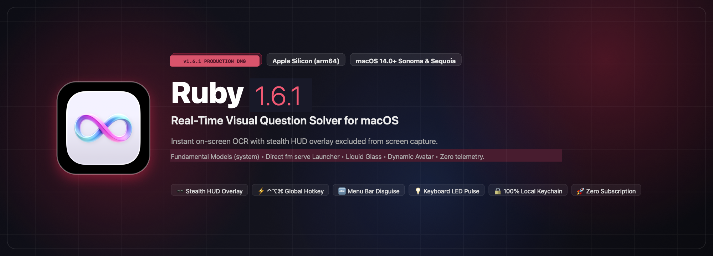
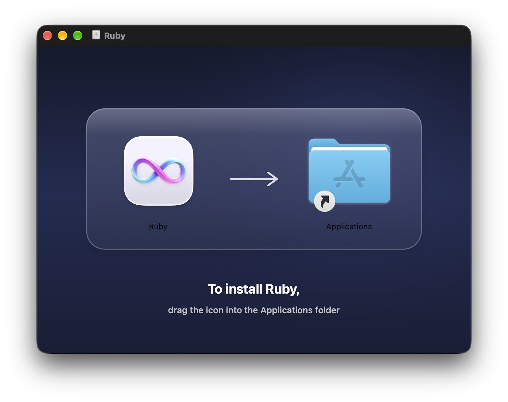
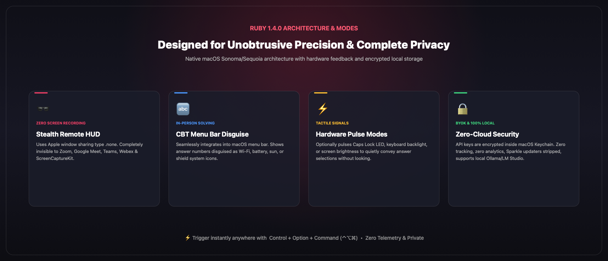
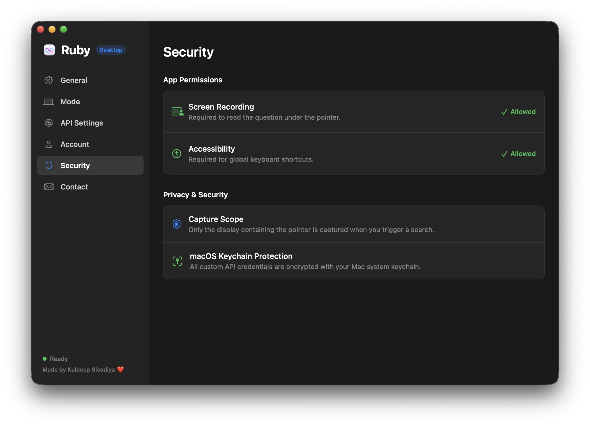

<p align="center">
  
</p>

<p align="center">
  <a href="https://github.com/kuldeepsisodiya/Ruby-AI/releases/download/v1.4.0/Ruby.dmg"></a>
  <a href="https://github.com/kuldeepsisodiya/Ruby-AI/releases/tag/v1.4.0"></a>
  
  
  
</p>

---

## 💎 Overview

**Ruby 1.4.0** is a native macOS desktop application engineered for real-time visual question solving and unobtrusive AI-assisted reasoning. Built from the ground up in **Swift & SwiftUI**, Ruby pairs Apple Vision OCR technology with a customizable multi-provider AI engine and hardware-level feedback systems.

Whether you're running local offline inference via **Ollama / LM Studio** or querying high-parameter models (**OpenAI GPT-4o, Claude, Mistral**), Ruby operates invisibly under your fingertips with zero telemetry, zero monthly subscriptions, and end-to-end local security.

---

## 🚀 Quick Download & Installation

### 1. Download the Installer
Download the verified disk image directly from the [v1.4.0 GitHub Release](https://github.com/kuldeepsisodiya/Ruby-AI/releases/tag/v1.4.0):

| Asset | Version | Architecture | Size | SHA-256 Checksum |
| :--- | :--- | :--- | :--- | :--- |
| [**Ruby.dmg**](https://github.com/kuldeepsisodiya/Ruby-AI/releases/download/v1.4.0/Ruby.dmg) | `1.4.0` | Apple Silicon (`arm64`) | `18.4 MB` | `7c7961e6345281cac3917f142fc572fa611d665f753dcf1cc717f35d5431fa46` |

> [!TIP]
> You can verify your download integrity anytime via the terminal:
> ```bash
> shasum -a 256 Ruby.dmg
> ```

---

### 2. Install to Applications
1. Double-click **`Ruby.dmg`** to mount the volume.
2. Drag **`Ruby.app`** into your **`Applications`** directory inside the custom installer platter:

<p align="center">
  
</p>

3. Unmount the disk image when complete.

---

### 3. macOS Gatekeeper (First-Time Launch)
Because Ruby is distributed directly outside the Mac App Store, macOS may show an *"Unidentified Developer"* or *"App is damaged"* prompt on your first launch.

To resolve this instantly, open **Terminal.app** and clear the quarantine flag:
```bash
xattr -cr /Applications/Ruby.app
```
*Alternatively: Right-click (Control-click) `Ruby.app` in Finder and select **Open**.*

---

## ⚡ Global Keyboard Shortcut

| Trigger Shortcut | Action |
| :--- | :--- |
| <kbd>Control</kbd> + <kbd>Option</kbd> + <kbd>Command</kbd> (`⌃⌥⌘`) | **Solve question under cursor** |
| <kbd>Control</kbd> + <kbd>Option</kbd> + <kbd>Command</kbd> + <kbd>Space</kbd> (`⌃⌥⌘Space`) | **Alternative solver trigger** |

Hover your mouse over any question, multiple-choice prompt, or on-screen diagram, tap the shortcut, and Ruby instantly processes the text and communicates the result via your configured mode. Built-in **0.8s debounce protection** prevents accidental duplicate calls.

---

## 🌟 Architectural Highlights

<p align="center">
  
</p>

---

## 🖥️ The 5 Solving Modes

<p align="center">
  
</p>

Ruby adapts to any test environment through 5 specialized output modes:

### 1. 🕶️ Remote Exam Mode (Stealth HUD)
* **Screen Sharing Immunity**: Uses native macOS `.sharingType = .none`.
* **Zero Recording Footprint**: The floating HUD window is **entirely omitted from screen capture and video calls** (Zoom, Google Meet, Microsoft Teams, Cisco Webex, ScreenCaptureKit, Loom, and OBS).
* Displays concise step-by-step reasoning and choice confirmation right where you need it.

### 2. 🔤 In-Person (CBT) Menu Bar Disguise
* Answers appear seamlessly within the macOS menu bar status area.
* Disguisable as ordinary system icons:
  * 📶 Wi-Fi Status
  * 🔋 Battery Level
  * ☀️ Display Brightness
  * 🛡️ Security Shield
  * 🔢 Discrete Minimalist Numbers / Letters

### 3. 💡 Caps Lock LED Pulse Mode *(Beta)*
* Uses low-level macOS IOKit hardware drivers to blink your physical keyboard's **Caps Lock LED**.
* Pulses the exact count of the correct answer (e.g., 3 pulses = Option C).

### 4. ⌨️ Keyboard Backlight Breathing Mode *(Beta)*
* Modulates the built-in keyboard illumination intensity in subtle rhythmic pulses to indicate the answer index without requiring visual focus.

### 5. ☀️ Screen Brightness Pulse Mode *(Beta)*
* Employs microscopic screen gamma adjustments to silently signal the answer option.

---

## ⚙️ Multi-Provider AI Architecture (BYOK)

<p align="center">
  
</p>

Ruby features a multi-preset provider engine with zero lock-in:

* **Preconfigured Presets**:
  * `OpenAI GPT-4o Mini (Default)`
  * `OpenAI GPT-4o Vision`
  * `Ollama Local (qwen2.5vl:7b)` (`http://localhost:11434/v1`)
  * `Ollama Local (llama3.2-vision)` (`http://localhost:11434/v1`)
  * `LM Studio Local` (`http://localhost:1234/v1`)
  * `Mistral / Ministral-3b`
  * `Custom Proxies / Anthropic Claude / DeepSeek`
* **Real-time Connectivity Testing**: Test endpoints, latency (ms), and response parsing live from the interface before saving.
* **Granular Controls**: Configure custom base URLs, endpoints, authentication schemes (`Bearer`, `X-API-Key`, `Custom Headers`), temperature, and custom JSON key paths.
* **Portable Presets**: Export and import non-sensitive configurations via JSON.

---

## 🔒 Security & Privacy by Design

<p align="center">
  
</p>

* **Encrypted macOS Keychain**: Sensitive API tokens and bearer keys are stored directly inside Apple's hardware-backed Keychain (`Security.framework`). Zero plaintext storage.
* **Redacted Logs**: In-app diagnostic logging automatically filters and masks bearer tokens, headers, and secret strings.
* **Sparkle & Trackers Stripped**: All telemetry, tracking scripts, and background update hooks have been entirely eliminated.
* **Direct Permission Verification**: In-app shortcuts to grant and verify macOS **Screen Recording** (for Vision OCR) and **Accessibility** (for global hotkeys).

---

## 🎛️ General Settings & Customization

<p align="center">
  
</p>

* **Dual Language Localization**: Full dynamic switching between **English** and **简体中文 (Simplified Chinese)**.
* **Dock Visibility**: Option to hide Ruby completely from the macOS Dock and run quietly from the menu bar.
* **Custom Hotkeys**: Rebindable trigger sequences with conflict detection.

---

## ❓ Frequently Asked Questions (FAQ)

<details>
<summary><b>1. Why does macOS say the app is damaged upon opening?</b></summary>
<br>
This is standard macOS Gatekeeper behavior for downloaded unsigned applications. Simply execute:

```bash
xattr -cr /Applications/Ruby.app
```
Then launch Ruby normally.
</details>

<details>
<summary><b>2. Can I use Ruby 100% offline without spending API credits?</b></summary>
<br>
Yes! Install <a href="https://ollama.com">Ollama</a> or <a href="https://lmstudio.ai">LM Studio</a>, pull a vision model (e.g. <code>ollama run qwen2.5vl:7b</code>), select the <b>Ollama Local</b> preset in Ruby's API Settings, and run completely offline without an internet connection.
</details>

<details>
<summary><b>3. Is Remote Exam Mode detectable on Zoom or Google Meet?</b></summary>
<br>
No. Ruby constructs its floating overlay using macOS AppKit <code>NSWindow.SharingType.none</code>. macOS explicitly prevents the window buffer from being captured by ScreenCaptureKit, Zoom, Teams, Webex, Google Meet, or recording utilities.
</details>

<details>
<summary><b>4. Which macOS versions are supported?</b></summary>
<br>
Ruby 1.4.0 is optimized for <b>macOS 14.0 Sonoma</b> and <b>macOS 15.0+ Sequoia</b> on Apple Silicon (M1, M2, M3, M4 series).
</details>

---

## 👨‍💻 Developer & Contact

* **Developer**: Kuldeep Sisodiya
* **Portfolio & Website**: [https://kuldeep.is-a.dev/](https://kuldeep.is-a.dev/)
* **Contact Email**: [kuldeepsisodiya901@gmail.com](mailto:kuldeepsisodiya901@gmail.com)

---

<p align="center">
  <b>Ruby 1.4.0</b> • Native macOS Engineering • Designed with ❤️ by Kuldeep Sisodiya
</p>
